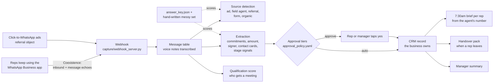

# WhatsApp Pipeline Capture

**In much of Nigerian B2B, the real CRM is WhatsApp.** Deals start with a number someone shared, rates get agreed in voice notes, and the "contract" is a screenshot. The CRM says `Source = Other`, and when a rep resigns, the pipeline leaves on their phone.

This repo is a working system that keeps WhatsApp as the place deals happen and builds the CRM from it automatically. It captures every chat on the company number, works out where each lead came from, pulls out who owes what by when, scores which leads deserve a meeting, hands over a departing rep's deals with full context, and sends each rep a 7:30am WhatsApp brief with ready drafts.

> All data in this repo is synthetic. The company, people, chats and amounts are invented by `data/make_data.py`. No client data is used anywhere.

**Recruiter takeaway:** I can design a revenue system around how a sales team actually works, and show with numbers that the pipeline became visible, the meetings got better and nothing was lost when someone left.

## Headline result

Same 320 leads, same six reps. The left column is the CRM the way reps keep it by hand. The right column is the CRM built from the captured chats.

| Measure | CRM kept by hand | Captured from WhatsApp |
| --- | --- | --- |
| Leads with a real source (not "Other" or blank) | 33.8% | **100%** |
| Quoted deals with the amount on record | 44.0% | **100%** |
| Deals past proposal with the signer named | 15.0% | **100%** |
| Active deals with a dated next action | 6.5% | **100%** |
| Stage matches what really happened | 78.1% | **100%** |
| Broken promises to clients a manager can see (last 21 days) | 0 | **19** |
| Departed rep's open deals with stage, amount, signer and next step | 0% | **100%** (22 deals) |

**Who gets a meeting.** The old rule booked anyone who agreed to a call. The new rule scores the chat first. The threshold was picked on August and September leads, then tested on October and November leads it had never seen:

| Oct-Nov test | Meetings | No-shows | Show rate | Wins from these meetings |
| --- | --- | --- | --- | --- |
| Book everyone who says yes | 95 | 40 | 57.9% | 12 |
| Book on chat score of 65 or more | 55 | 11 | **80.0%** | 12 |

29 no-show meetings avoided and no win lost. The test window holds only 12 wins, so read that last part as encouraging, not proven. Leads under the threshold go to nurture, not the bin.

**The thesis this proves:** reps don't fail to update the CRM because they are lazy. The CRM sits outside where the work happens. Capture the work where it happens and the data problem mostly disappears, along with a lot of what reps get blamed for.

## What I did for real (Plumemark client work)

For a Nigerian B2B company with leads coming mostly from paid ads plus a team of field agents, I designed the integrated pipeline from marketing through sales to finance, set it up in GoHighLevel and integrated WhatsApp. The pipeline worked, but lead scoring still fell short: meeting volume was there and no-shows and cancellations kept eating the calendar, because "qualified" had never been defined by who actually shows up and buys. Email follow-up also wasn't landing, so we moved follow-up to WhatsApp, where clients actually reply. This repo rebuilds those lessons on synthetic data: qualification judged by show-ups and wins, and WhatsApp treated as the system of record rather than a side channel.

## The problem, in plain words

- **Reps don't update the CRM.** The chat already holds the update. Asking reps to retype it is the problem.
- **A rep quits and the pipeline goes with them.** The deals live on a personal phone.
- **Follow-ups slip.** "Call me Monday 8am" sits in a chat nobody else can see.
- **Meetings no-show.** Every lead who says "ok" gets a meeting, and half don't turn up.
- **Nobody knows which channel works.** Ads, field agents and referrals all land in WhatsApp as "Other".

## How it works



1. **Data** (`data/make_data.py`). One invented Lagos B2B services company, 6 reps, 320 leads from Click-to-WhatsApp ads, field agents, referrals, a web form and organic chats. 2,991 messages written as real WhatsApp Cloud API webhook events, including 151 voice notes, contact cards and the ad referral object Meta attaches to the first message from an ad. Every planted fact is in `answer_key.json`.
2. **Capture** (`capture/`). With WhatsApp Coexistence, reps keep the Business app on their phone. Inbound messages arrive as `messages` events and what reps send from the app arrives as `smb_message_echoes`. Nobody exports chats or remembers to log anything. `webhook_server.py` shows the receiving contract (verification handshake and signature check).
3. **Source detection** (`pipeline/build_records.py`). The ad ID from the referral object, an agent code (`AGT-03`) in the first message, a referrer's name, or a phone that matches a web form.
4. **Extraction** (`pipeline/extract.py`, `pipeline/timeparse.py`). Who owes what by when ("Abeg call me Monday by 10" is a call the rep owes on Monday at 10:00), quoted amounts in any naira format, who signs, and shared contact cards. Date conventions are in `docs/COMMITMENT_RULES.md`. An optional AI mode handles phrasing the rules miss.
5. **Approval tiers** (`config/approval_policy.yaml`). Source, contacts and commitments are logged automatically. Stage, amount and signer wait for a person. Any message about price is always written or edited by the rep. AI fills the record; it does not decide what a stage means (`config/stage_rules.yaml`).
6. **Commitment tracking.** Every promise gets a status: kept, pending, overdue (rep) or lapsed (client). Every live deal gets a dated next action, even when nobody typed one.
7. **Qualification** (`pipeline/qualify.py`). A score from what the lead said before the meeting was booked: size, sites, industry, timeline, a specific time, price-first questions and source, with a plain reason for every point.
8. **Handover** (`pipeline/handover.py`). When a rep leaves, each open deal moves to the rep with the lightest load, with stage, amount, signer, what we owe, what they owe and the last message. Clients keep messaging the same company number.
9. **The 7:30am brief** (`pipeline/brief.py`, `config/playbook.yaml`). Up to five actions per rep, ranked, each with a draft from the messaging playbook and a `wa.me` link that opens the client's chat with the text typed. It respects WhatsApp's 24-hour window: the brief opens with a pre-approved template, and each item says whether the agent can send inside the window or the rep should send from their app. Reps reply "done 1" or send a voice note, and the update is logged.

A sample brief (`outputs/briefs/R2.txt`):

```text
Good morning Amaka. Here's today (Mon 16 Nov):

*1. Due today*: Yusuf Nwachukwu
   the call they booked, today 10:00
   Draft: "Good morning sir. As agreed, I'll be calling you shortly. Is now still a good time?"
   outside the 24-hour window: tap the link and send from your app
   https://wa.me/2348130364349?text=Good%20morning%20sir...
```

## How accurate is the extraction

| Check | Result |
| --- | --- |
| Who owes what, by when (precision / recall, 490 commitments) | 100% / 100% |
| Broken rep promises caught (precision / recall, 69 planted) | 100% / 97.1% |
| Source channel and detail, amount, signer, contact cards, stage | 100% each |
| **Hand-written messy set** (32 messages: Pidgin, negations, reschedules, past tense) | **87.5%** |

The generated chats use phrasing the rules were written for, so those scores prove the plumbing, not the language understanding. The messy set (`data/messy_messages.csv`) is the honest number. The 4 misses are in `outputs/eval_messy_set.csv`: a reschedule that names two days ("Monday no go work, make it Tuesday 11am"), "after 2", a negation followed by a real request, and a request with no "me" in it. That is the case for the optional AI mode, and the reason AI output still goes through the same approval tiers.

## Stack

| Tool | Job | Cost |
| --- | --- | --- |
| Python 3.11+ with pandas and PyYAML | Capture, extraction, scoring, briefs | Free |
| WhatsApp Business app + Cloud API (Coexistence, via a provider) | Reps keep the app; every message reaches the webhook | Meta's per-message pricing for template sends |
| Speech-to-text (any) | Voice notes into text | Pay per minute |
| Claude API (optional) | AI extraction mode with a local cache | Pay per use |
| Any CRM (HubSpot, GoHighLevel, Pipedrive) or a sheet | Where the approved record lives | Varies |

## Setup and usage

```bash
git clone https://github.com/FeyisayoDaisi/revops-whatsapp-pipeline.git
cd revops-whatsapp-pipeline
python -m venv .venv && source .venv/bin/activate   # Windows: .venv\Scripts\activate
pip install -r requirements.txt
python run_all.py          # about 10 seconds; open outputs/report.html
python -m pytest -q        # unit tests for the date, amount, owner and signer rules
```

**Main outputs**

| File | What is in it |
| --- | --- |
| `outputs/deals_captured.csv` | one row per conversation: rep, source, stage, amount, signer, contacts, days quiet, next action date |
| `outputs/commitments.csv` | every promise: owner, topic, due, the exact words, status |
| `outputs/crm_updates.csv` | every proposed CRM change with its evidence message and approval tier |
| `outputs/lead_scores.csv` | qualification score and the reason for every point |
| `outputs/qualification.json` | threshold, train and test results, show rate by source |
| `outputs/handover.md` | the departed rep's deals, one block each, with what the hand-kept CRM had |
| `outputs/briefs/*.txt`, `outputs/manager_summary.html` | the 7:30am briefs and the manager view |
| `outputs/before_after.csv`, `outputs/report.html` | the headline comparison and a one-page demo report |
| `outputs/eval_*` | extraction scores, every miss, the messy-set results |

**Mapping to a real CRM.** In HubSpot: source to `hs_analytics_source` plus a custom `whatsapp_source_detail`, amount to `amount`, stage to `dealstage`, next action to `hs_next_step` with a task, signer to an associated contact with a "signs" label. In GoHighLevel: opportunity stage, monetary value, a custom "Who signs" field and tasks. Store `ctwa_clid` to send conversions back to Meta's Conversions API, so ad spend optimises for buyers, not chats.

## Going live

- Connect each rep's company WhatsApp Business number to the Cloud API through a provider using Coexistence. Reps keep the app. Only 1:1 chat history syncs at onboarding (up to six months); group chats stay in the app.
- Subscribe the webhook to `messages` and `smb_message_echoes`.
- Use company-owned numbers, not personal lines. This alone keeps the pipeline when someone leaves.
- Add a line to the privacy notice that conversations are recorded and processed to manage the sales relationship (Nigeria Data Protection Act 2023). Keep marketing messages opt-in.
- Start with the tiers as shipped. Loosen "approve" items only after a few weeks of seeing them right.

## Limits

- Synthetic data. The rules are tuned on chats written by the same generator; the messy set is the realistic check, and it is small.
- Calls happen off WhatsApp. A call counts as kept when the rep messages around the agreed time ("thanks for your time", "I called but couldn't reach you").
- The qualification test window is two months. Re-pick the threshold quarterly on real outcomes.
- Nothing here sends a WhatsApp message. Sending is a provider API call behind the same approval tiers.
